# Actividad 4 — Ciberseguridad (Tecmilenio)


|---|---|
| Alumno | César Julián Espronceda Pantoja |
| Matrícula | AL07040765 |
| Materia | Ciberseguridad |
| Docente | Francisco Gómez Rubio |
| Fecha | 16 de noviembre del 2026 |

ALCARACIÓN: ESTE README ES LO MISMO QUE EL DOCUMENTO QUE SE ENCUENTRA EN EL FOLDER DE "Documento de la actividad" PERO LO ADAPTE A MD PARA QUE FUERA MÁS CÓMODO DE LEER Y DE VERIFICAR EL CÓDIGO EN GENERAL

## Introducción

En este documento se presenta la Actividad 4 de esta misma materia, la cual la dividí en 5 fases, las cuáles vienen siendo: vulnerabilidades de aplicación web, protección de APIs, diseño de red segura, seguridad perimetral y evaluación de riesgos.

Al igual le dejo el link al repositorio, en onde esta documentado todo junto a las capturas de pantalla para que sea más fácil de visualizar: [https://github.com/CesarEsproncedaP/actividad4-ciberseguridad](https://github.com/CesarEsproncedaP/actividad4-ciberseguridad)

## Fase 1: Análisis de vulnerabilidades en aplicación web

### Entorno de pruebas

Levanté DVWA en un contenedor de Docker en el puerto 8081 y usé OWASP ZAP como proxy, usando la ventana que me abría e iniciaba sesión en esa misma, el nivel de seguridad de DVWA quedó en **"Low"**, tal como lo es solicitado en la actividad, al igual que con ese nivel la aplicación no tiene una medida de protección y permite ver claramente como se explota cada vulnerabilidad.

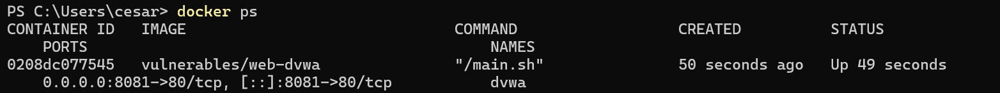
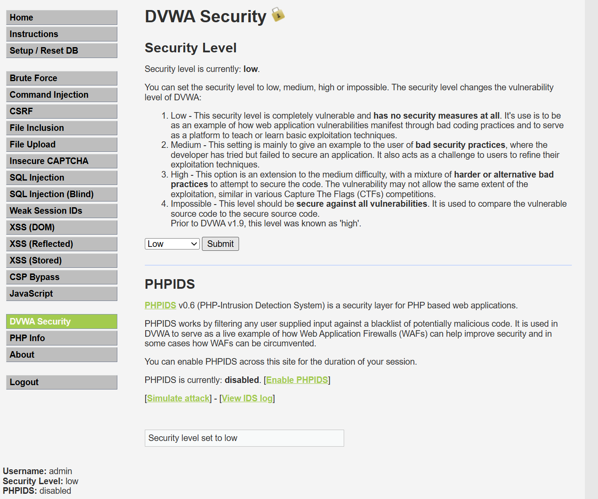
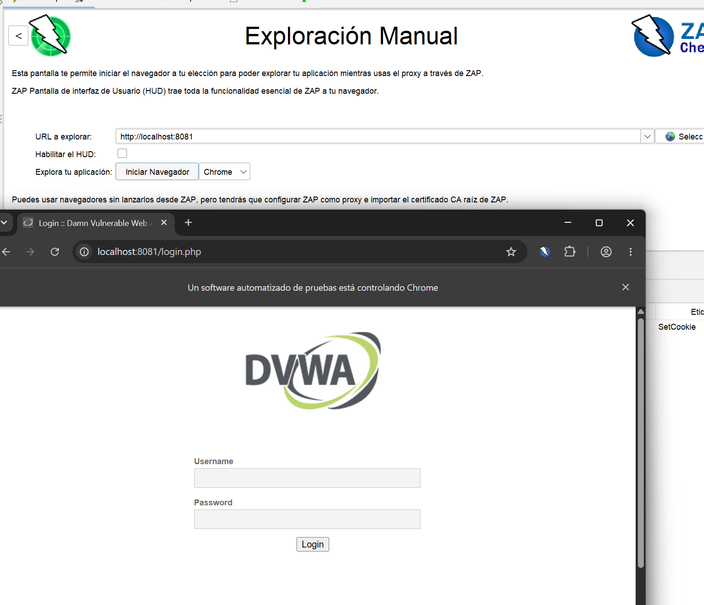

### Vulnerabilidad 1: Inyección SQL

La primera vulnerabilidad que identifiqué fue esta misma, en el módulo de "SQL Injection", para comprobarla usé el payload **"1' OR '1'='1"**, el cual regresó los 5 usuarios registrados en la base en vez de uno solo, por lo que se puede ver que la aplicación concatena la entrada sin validarla.

Para ver cuanto fue el impacto probé con el payload **"1' UNION SELECT user, password FROM users#"**, el cuál expuso los 5 usuarios de la tabla users junto con sus hashes, lo que permitiría que un hacker haga un ataque de fuerza bruta offline sobre esas contraseñas.

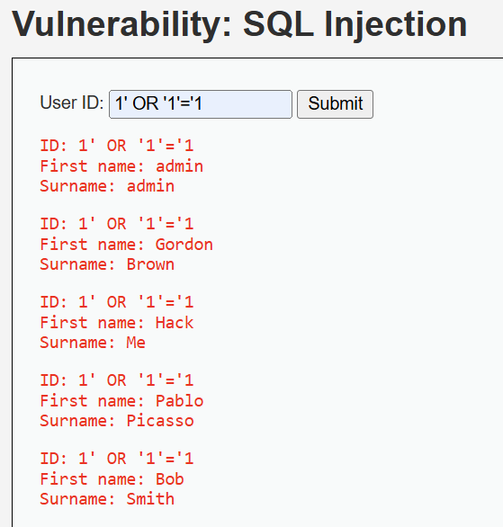
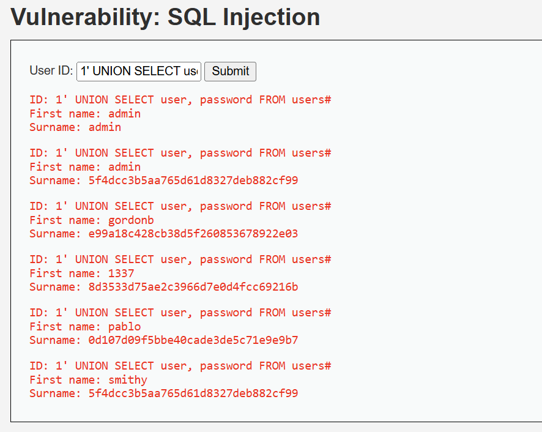
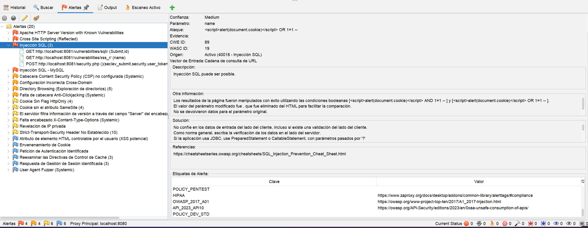

### Vulnerabilidad 2: Cross-Site Scripting

La segunda vulnerabilidad la encontré en el módulo XSS (Reflected), donde el parámetro name tampoco verifica la entrada antes de reflejar la respuesta, al enviar el payload **"\<script>alert('XSS')\</script>"** el navegador ejecutó el script de inmediato, demostrando que cualquier código de JavaScript que un atacante inyecte ahí se ejecuta en el navegador de la víctima.

Esto podría tener un impacto real ya que si un atacante manda un enlace manipulado a un usuario con sesión activa podría robar su cookie de sesión o redirigirlo a un sitio de phishing, por lo que podría resultar en un robo de sesión.

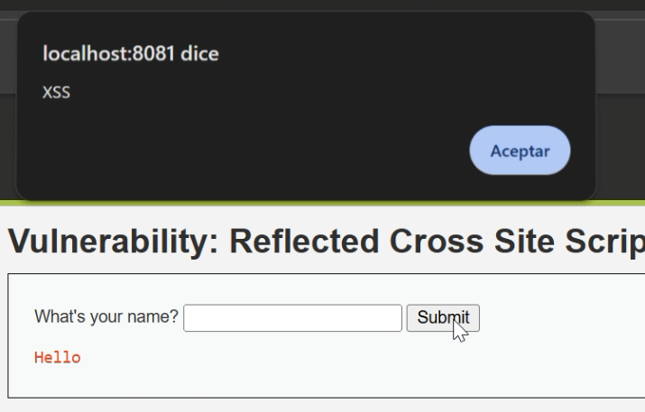
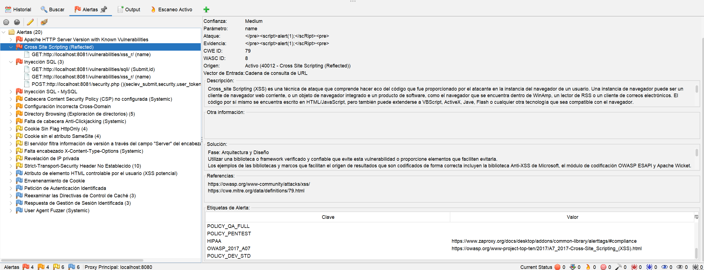

### Vulnerabilidad 3: Directory Browsing

Como tercera vulnerabilidad elegí trabajar con el control de acceso roto, debido a que el escaneo activo de ZAP detectó 5 instancias de Directory Browsing bajo /dvwa/, es decir el servidor permite listar el contenido de los directorios sin pedir algún tipo de autenticación, exponiendo la estructura interna del sitio, revelando scripts, respaldos o configuraciones sensibles.

Como evidencia complementaria exploté el módulo File Inclusion con path traversal **"(?page=../../../../../../etc/passwd)"**. El servidor devolvió el archivo completo, exponiendo 15 cuentas del sistema, incluyendo root y MySQL, sin ninguna restricción.

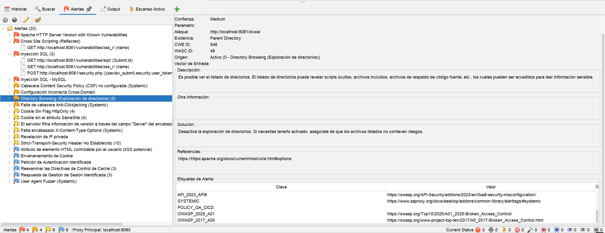
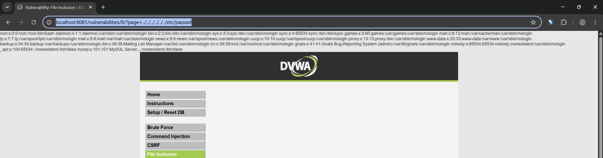

### Reporte de OWASP ZAP

Además de las capturas ejecuté un escaneo activo completo contra "http://localhost:8081", el cuál generó 20 alertas en total, entre ellas las 3 que documenté arriba, el reporte completo se encuentra en el repositorio en la carpeta [`01_zap`](01_zap/).

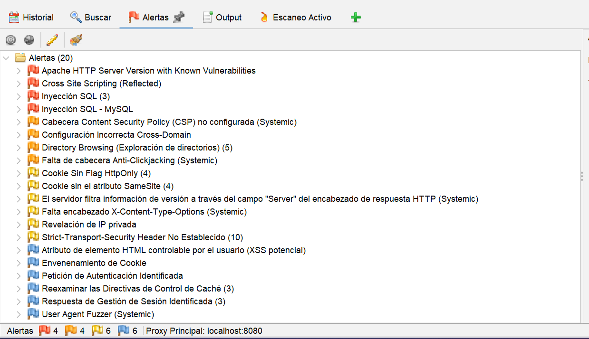

## Fase 2: Protección de las API

### Arquitectura del servidor

Para esta fase armé un servidor en Node.js con Express, debido a que es la tecnología con la que me siento más cómodo, el server expone 2 rutas: **"POST /login"** que recibe un usuario y una contraseña y si son correctos regresan un JWT firmado, y **"GET /perfil"** la cuál es la ruta protegida y solo responde si se le manda un token válido en el encabezado Authorization.

Las contraseñas de los usuarios no se guardan en texto plano, si no como un hash generado con bcrypt tal como se esperaría en cualquier API real y el JWT se firma con una clave secreta y expira a la hora, lo que limita la ventana de tiempo en la que un token robado podría seguir siendo útil.

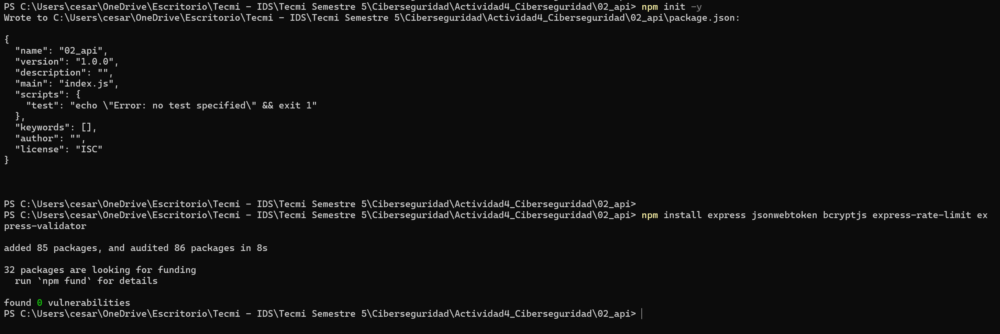
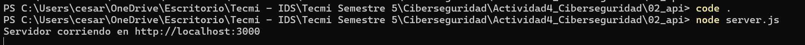

### Autentificación con JWT

Para probar la autenticación usé Postman, primero mandé una petición POST a /login con un usuario y contraseña correctos, lo cuál me regresó un JWT junto a un mensaje de **"Login exitoso"**. Después probé con una contraseña incorrecta y el servidor respondió con un código 401 y un mensaje de **"Usuario o contraseña incorrectos"**, sin dar ninguna pista si el error fue el usuario o la contraseña, lo cuál considero que es una buena práctica para no facilitarle información a un atacante.

También probé el endpoint protegido /perfil sin mandar ningún token, el cuál respondió con un 401 y el mensaje **"Token no proporcionado"**, y después repetí la misma petición pero ya con el token obtenido del login, usando la pestaña de Authorization de Postman con el tipo Bearer Token. En ese caso el servidor respondió con un 200 y los datos del usuario decodificados del token, confirmando que la validación del JWT funciona correctamente en ambos sentidos.

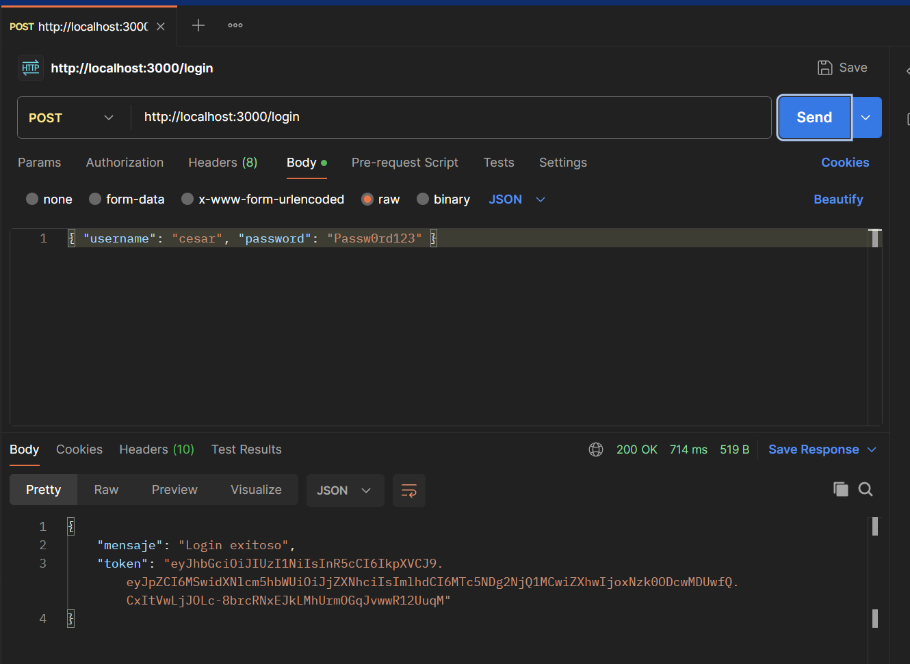
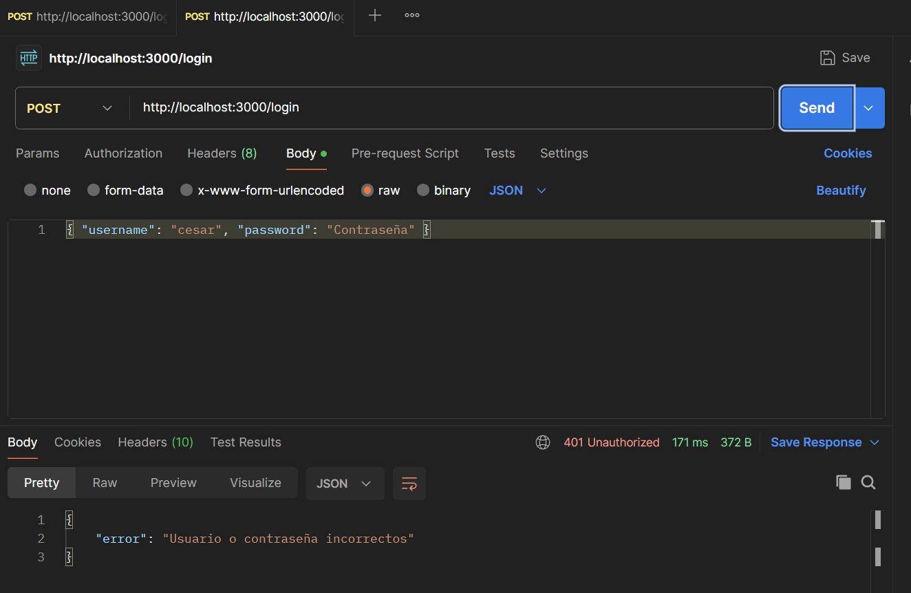
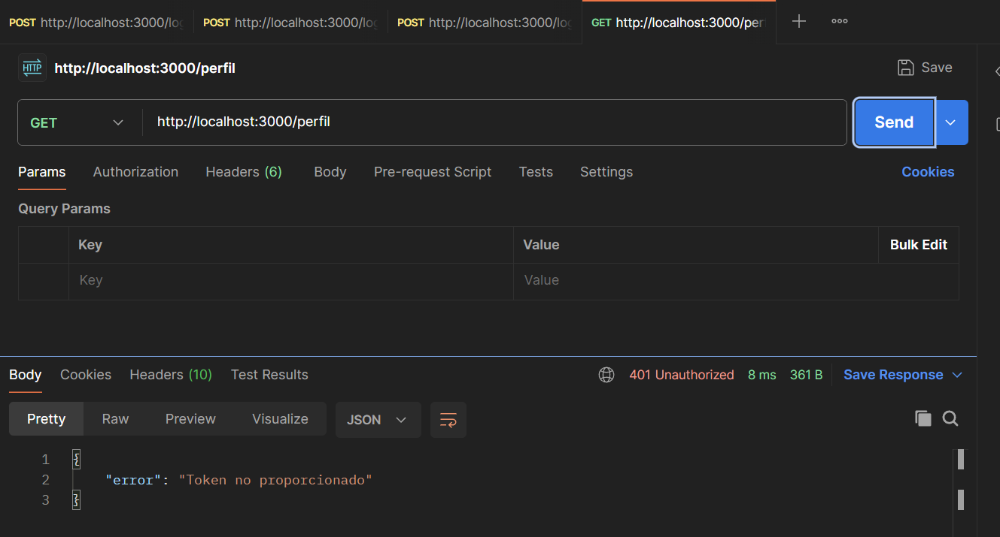
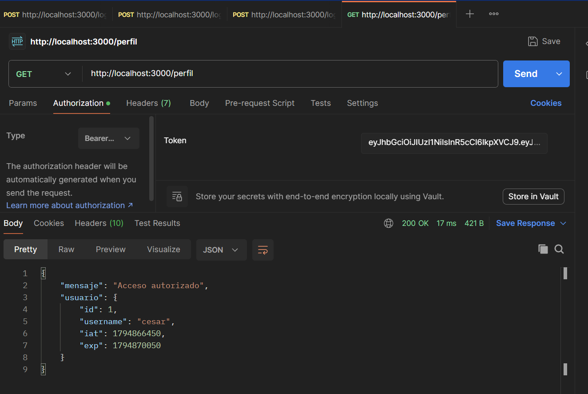

### Validación de entradas

Para bloquear ataques de inyección agregué validación de entradas en /login con la librería express-validator, la cuál exige que el campo username solo contenga letras y números, y que la contraseña tenga al menos 6 caracteres, al intentar mandar un payload de inyección como usuario (cesar' OR '1'='1), el servidor respondió con un código 400 y un mensaje explicado, por lo que la petición ni siquiera llega a intentar validarse contra la base de usuarios.

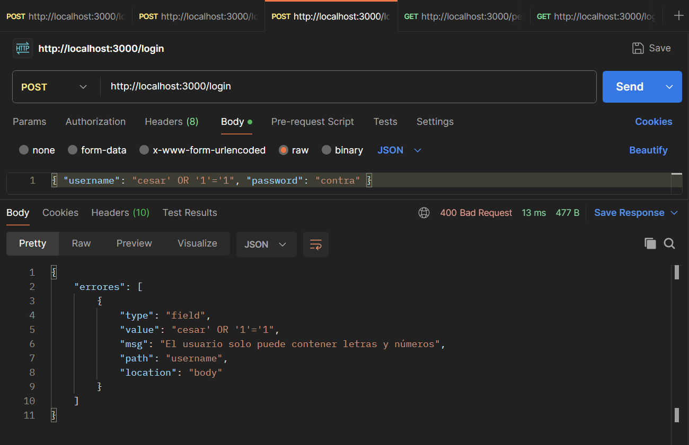

### Límite de solicitudes

Por último, configuré un límite de 100 solicitudes por minuto por dirección IP con la librería express-rate-limit, para comprobarlo usé el Collection Runner de Postman y mandé 105 solicitudes seguidas de login a la misma ruta, las primeras 100 regresaron un código 200 con normalidad, pero a partir de la 101 hasta la 105 el servidor empezó a responder con 429 y el mensaje **"Demasiadas solicitudes, intenta de nuevo en un minuto"**, lo que confirma que el límite funciona tal como se configuró.

Toda esta colección de pruebas la exporté en formato JSON, el cuál está adjuntado en la carpeta [`02_api`](02_api/) del repositorio.

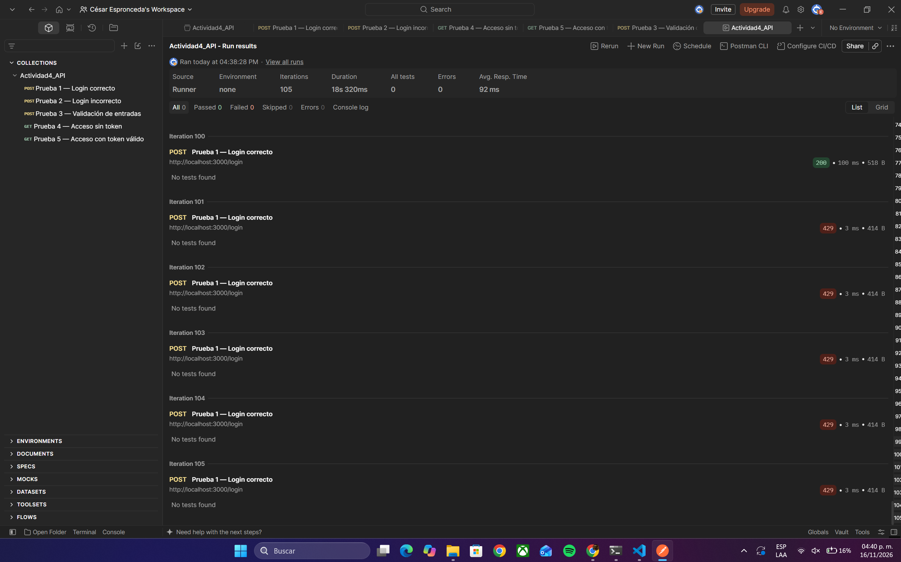

## Fase 3: Diseño de red segura

El siguiente diagrama representa 3 VLAN (DMZ, red interna e IoT), un firewall pfSense con Snort como IDS/IPS, un switch administrable en modo trunk, y una VPN IPsec para el acceso remoto, aplicando el principio de mínimo privilegio: la VLAN de IoT no tiene visibilidad hacia la red interna, la DMZ solo expone los puertos 80/443 necesarios y el acceso remoto a la red interna solo se permite autenticando vía VPN.

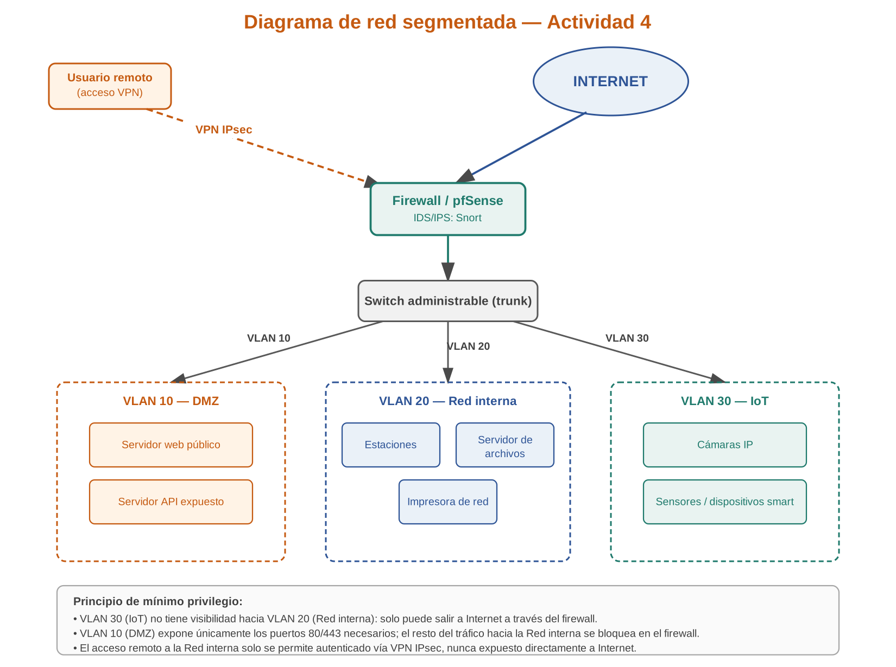

El diagrama editable (`.drawio`) y la imagen están disponibles en la carpeta [`03_red`](03_red/).

## Fase 4: Implementación de seguridad perimetral

### Entorno de pruebas

Armé 2 máquinas virtuales en VirtualBox conectadas ambas por una red solo-anfitrión, las cuales son: pfSense con su LAN configurada en 192.168.1.1/24 y DHCP habilitado, y Kali Linux como equipo de pruebas.

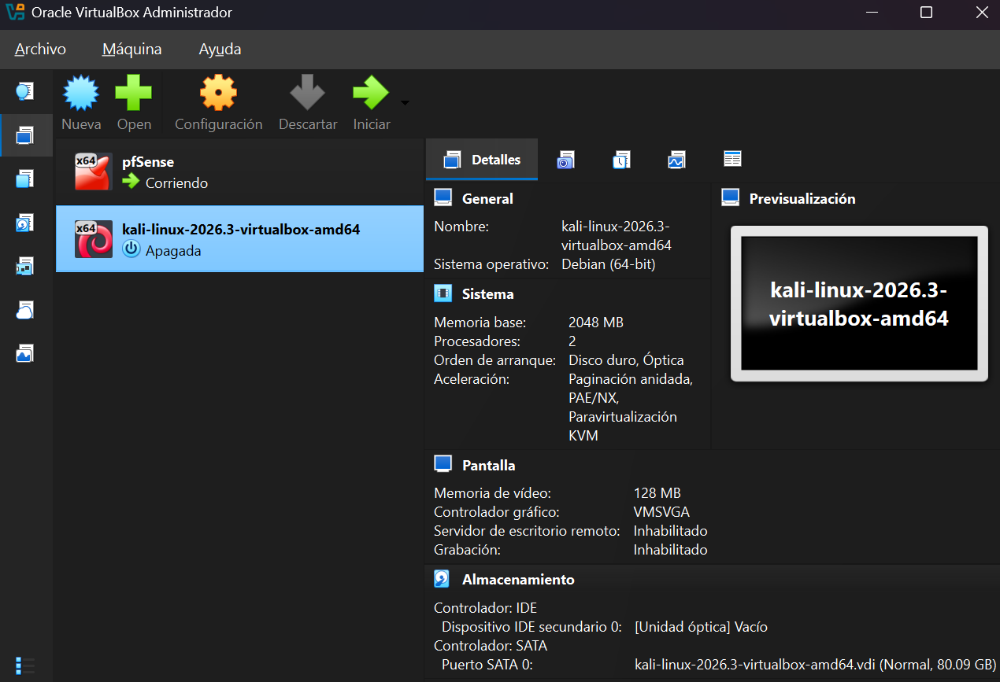
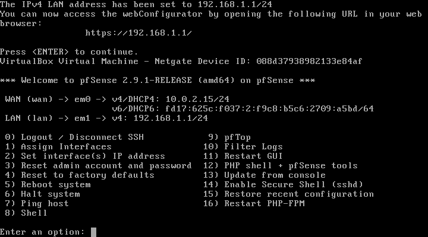

### Reglas de firewall

Configuré 3 reglas en Firewall, específicamente en las reglas del LAN: bloquear el tráfico de una IP no autorizada hacia la red interna, bloquear un alias de dominios de phishing y permitir únicamente tráfico web HTTP de salida.

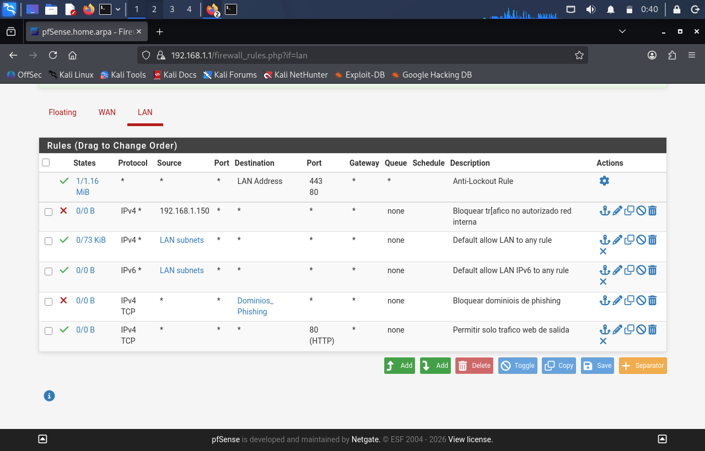

### Snort (IDS/IPS)

Instalé el paquete de Snort en pfSense y configuré la interfaz LAN con una regla personalizada para detectar escaneo de puertos:

```
alert tcp any any -> $HOME_NET any (msg:"Posible escaneo de puertos detectado"; flags:S; threshold: type threshold, track by_src, count 5, seconds 10; sid:1000001;)
```

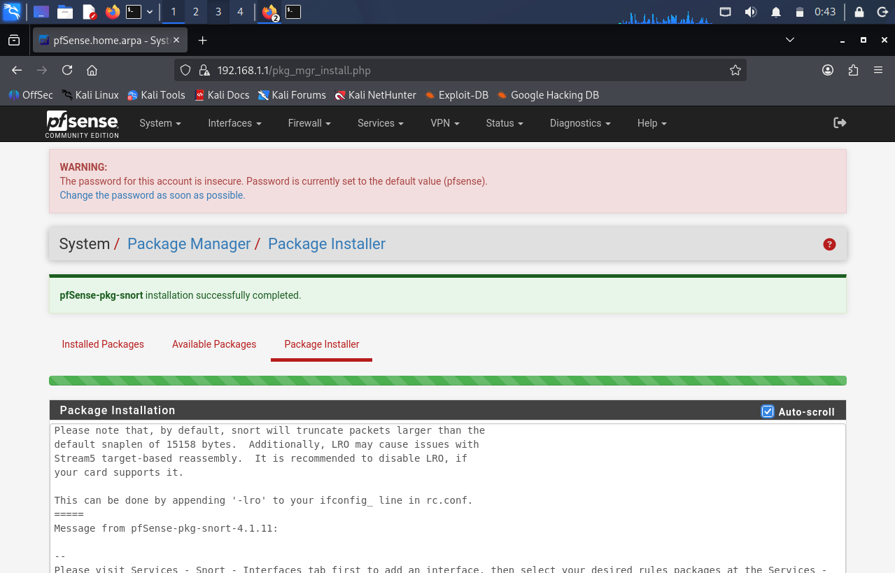

### Simulación del ataque y validación

Desde Kali corrí un escaneo de puertos ("nmap -sS") contra la IP de pfSense, el cuál detectó los puertos 53, 80 y 443 abiertos. Snort generó de inmediato 8 alertas con el mensaje "Posible escaneo de puertos detectado", confirmando que la regla personalizada funciona correctamente.

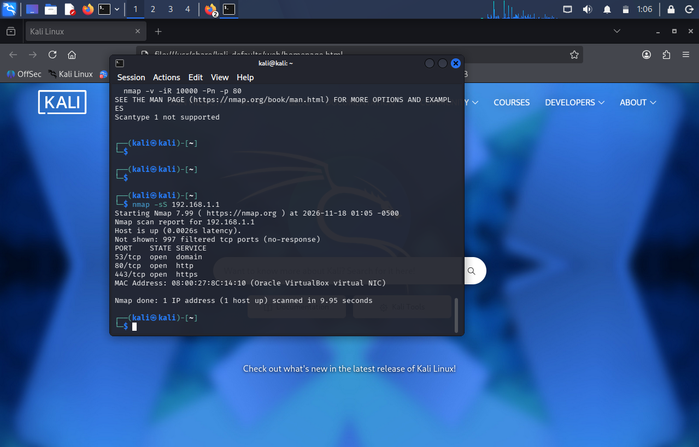
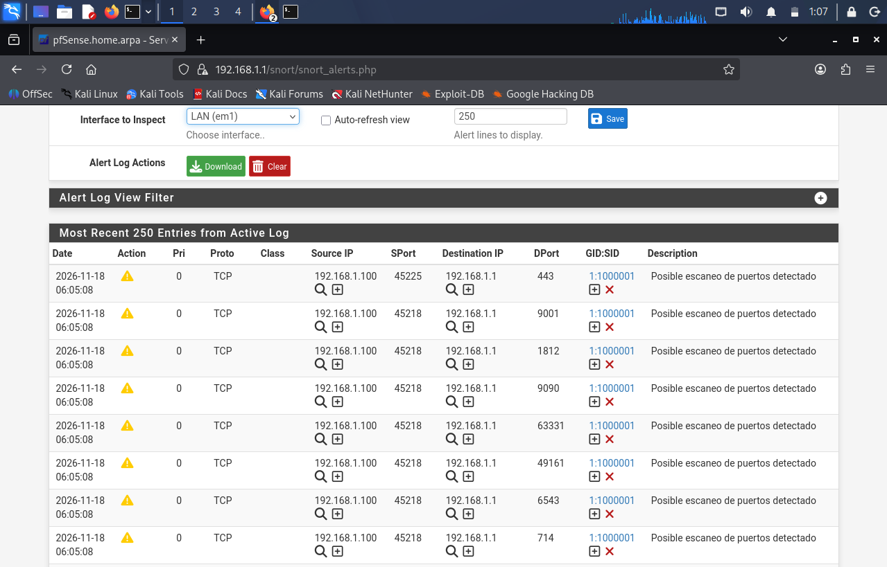

La configuración completa de pfSense se exportó en formato XML y está disponible en la carpeta [`04_perimetral`](04_perimetral/) del repositorio.

## Fase 5: Evaluación de riesgos

Prioricé 4 amenazas identificadas a lo largo de la actividad en una matriz 5x5 de probabilidad contra impacto, donde el riesgo de cada celda es el producto de ambos valores:

| Prob. \ Impacto | 1 Muy bajo | 2 Bajo | 3 Medio | 4 Alto | 5 Muy alto |
|---|---|---|---|---|---|
| **5 Muy alta** | 5 | 🟠 10 (Escaneo) | 🔴 15 | 🔴 20 | 🔴 25 |
| **4 Alta** | 4 | 8 | 🟠 12 (XSS) | 🔴 16 | 🔴 20 (SQLi) |
| **3 Media** | 3 | 6 | 9 | 🟠 12 (Acceso) | 🔴 15 |
| **2 Baja** | 2 | 4 | 6 | 8 | 🟠 10 |
| **1 Muy baja** | 1 | 2 | 3 | 4 | 5 |

Detalle de cada amenaza y su estrategia de mitigación:

| Amenaza | Probabilidad | Impacto | Riesgo | Estrategia de mitigación |
|---|---|---|---|---|
| **Inyección SQL** | 4 (Alta) | 5 (Muy alto) | 20 — Crítico | Usar consultas parametrizadas en vez de concatenar entradas, validar y sanear todos los campos del lado del servidor y aplicar el principio de mínimo privilegio en el usuario de la base de datos. |
| **Cross-Site Scripting Reflejado** | 4 (Alta) | 3 (Medio) | 12 — Alto | Escapar toda salida que incluya datos del usuario, aplicar una Content-Security-Policy y marcar las cookies de sesión como HttpOnly y Secure. |
| **Acceso no autorizado por falta de segmentación** | 3 (Media) | 4 (Alto) | 12 — Alto | Mantener la segmentación por VLAN con mínimo privilegio y reforzarla con reglas de firewall explícitas en pfSense que bloqueen el tráfico no autorizado hacia la red interna. |
| **Escaneo de puertos / reconocimiento de red** | 5 (Muy alta) | 2 (Bajo) | 10 — Medio | Mantener activo el IDS/IPS con reglas de detección de escaneo, cerrar o filtrar puertos que no se usan y revisar periódicamente los logs y alertas del firewall. |

## Estructura del repositorio

```
actividad4-ciberseguridad/
├── README.md
├── Act4_CJEP_Ciberseguridad.pdf / .docx   # Documento final
├── capturas/                   # Todas las capturas usadas en este README
├── 01_zap/                     # Reporte de OWASP ZAP (Fase 1)
├── 02_api/                     # server.js y colección de Postman (Fase 2)
├── 03_red/                     # Diagrama de red (.png y .drawio) (Fase 3)
├── 04_perimetral/              # Configuración XML de pfSense (Fase 4)
└── 05_riesgos/                 # Evidencia de la matriz de riesgos (Fase 5)
```
